# Guia de regressão linear para iniciantes

Para quem nunca viu regressão e precisa fazer a Atividade 1 de ACH2036.
Cobre tudo que a tarefa usa, desde o zero, seguindo o curso
[STAT 501 da Penn State](https://online.stat.psu.edu/stat501/) (Lições 1 a 4 e 9).

Como ler:

- Cada conceito segue o mesmo molde: **Em 1 frase** -> fórmula -> exemplo com número real -> **Armadilha**.
- Termos em inglês entre parênteses: são os nomes que aparecem no STAT501 e na saída do Python.
- Números com ponto decimal (`0.395`), igual à saída do Python.
- Exemplo principal (fio condutor): 58 hospitais do STAT501, `InfctRsk` (risco de infecção, %) vs `Stay` (dias de internação). É o mesmo exemplo do notebook `SLR_Hospital_Infection.ipynb` e das figuras do enunciado. Dados em [`docs/data/hospitalinfct_reg1and2.txt`](data/hospitalinfct_reg1and2.txt).
- Os trechos de Python rodam da raiz do projeto, em ordem, numa mesma sessão (notebook ou script). Ambiente: `uv sync` (ver [README](../README.md)).
- As figuras deste guia saem de [`scripts/make_figures.py`](scripts/make_figures.py).

## Sumário

0. [Mapa: etapa da tarefa -> seção do guia](#0-mapa-etapa-da-tarefa---seção-do-guia)
1. [Fundamentos (pré-requisitos)](#1-fundamentos-pré-requisitos)
2. [Regressão linear simples](#2-regressão-linear-simples-stat501-lição-1)
3. [Inferência: testes e intervalos](#3-inferência-testes-e-intervalos-stat501-lições-2-e-3)
4. [Lendo a tabela do statsmodels campo a campo](#4-lendo-a-tabela-do-statsmodels-campo-a-campo)
5. [Diagnóstico pelos resíduos](#5-diagnóstico-pelos-resíduos-stat501-lição-4)
6. [Transformações de escala](#6-transformações-de-escala-stat501-lição-9)
7. [Roteiro da tarefa](#7-roteiro-da-tarefa)
8. [Glossário PT/EN](#8-glossário-pten)

---

## 0. Mapa: etapa da tarefa -> seção do guia

| Etapa do enunciado | O que pede | Seção |
|---|---|---|
| 3.1.1 | Gráfico de dispersão + comentário | [2.2](#22-gráfico-de-dispersão-scatter-plot) |
| 3.1.2 | Tabela do ajuste + comentar R² ajustado | [2.3 a 2.9](#23-a-reta-ŷ--b₀--b₁x), [4](#4-lendo-a-tabela-do-statsmodels-campo-a-campo) |
| 3.1.2 | Reta + intervalo de confiança + intervalo de predição | [3.4](#34-ic-da-média-vs-ip-de-uma-nova-observação) |
| 3.1.2 | Histograma, resíduo vs predito, QQ-plot | [5.2 a 5.4](#52-resíduos-vs-valores-preditos-residuals-vs-fits) |
| 3.1.3 | Premissas LINE: quais valem, quais falham | [5.6](#56-checklist-line) |
| 3.2 | Testar 9 transformações, escolher a melhor | [6](#6-transformações-de-escala-stat501-lição-9) |
| 3.3 | Repetir 3.1 com os dados transformados | [6.5](#65-ajustar-e-interpretar-o-modelo-transformado), [7](#7-roteiro-da-tarefa) |

Pressa? Leia 1.6, 2.3 a 2.7, 4, 5 e 6. Base zero? Leia na ordem.

---

## 1. Fundamentos (pré-requisitos)

### 1.1 Dados: observação, variável, X e Y

**Em 1 frase:** regressão usa uma variável (X) para explicar ou prever outra (Y).

- **Observação** (*observation*): uma linha da tabela. Ex.: um hospital.
- **Variável** (*variable*): uma coluna. Ex.: `Stay`, `InfctRsk`.
- **n**: número de observações. Hospitais: n = 58.
- **Y, variável resposta** (*response*, *dependent*): o que queremos explicar. Vai no **eixo vertical**.
- **X, variável preditora** (*predictor*, *explanatory*, *independent*): o que usamos para explicar. Vai no **eixo horizontal**.

Na tarefa:

| Dataset | Y (resposta) | X (preditora) |
|---|---|---|
| Treadwear | `groove` (profundidade do sulco do pneu) | `mileage` (milhas rodadas) |
| Alligators | `weight` (peso) | `length` (comprimento) |
| ConcPatog | `CPatog2` (concentração do patógeno 2) | `CPatog1` (concentração do patógeno 1) |

**Regressão linear simples** (*simple linear regression*, SLR, RLS) = **um** X só, relação em forma de **reta**.

### 1.2 Média, variância e desvio padrão

**Em 1 frase:** a média diz onde os dados estão; o desvio padrão diz o quanto eles se espalham.

Mini-exemplo usado no guia todo: notas de 5 alunos = `2, 4, 5, 4, 6`.

- **Média** (*mean*): `x̄ = Σx / n` -> `(2 + 4 + 5 + 4 + 6) / 5 = 4.2`. O símbolo `Σ` quer dizer "some tudo".
- **Desvio** (*deviation*): `valor - média`. Ex.: `2 - 4.2 = -2.2`.
- **Variância** (*variance*): `s² = Σ(x - x̄)² / (n - 1)` -> `8.8 / 4 = 2.2`. Passo a passo abaixo.
- **Desvio padrão** (*standard deviation*, SD): `s = √s²` -> `√2.2 = 1.483`.

**Variância passo a passo.** Mede o quanto os dados se espalham em volta da média.

| nota `x` | desvio `x - x̄` | desvio² `(x - x̄)²` |
| --- | --- | --- |
| 2 | -2.2 | 4.84 |
| 4 | -0.2 | 0.04 |
| 5 | 0.8 | 0.64 |
| 4 | -0.2 | 0.04 |
| 6 | 1.8 | 3.24 |
| **soma** | **0** | **8.80** |

1. **Desvio:** distância de cada nota até a média, com sinal. Nota 2 está 2.2 abaixo; nota 6, 1.8 acima.
2. **Eleva ao quadrado:** desvios somam **sempre 0** (positivos cancelam negativos), para qualquer dado. Somar desvio cru não mede nada. Quadrado deixa tudo positivo e pesa mais quem está longe: 2.2 vira 4.84, 0.2 vira só 0.04.
3. **Soma:** `8.8` = espalhamento total.
4. **Divide por `n - 1 = 4`:** espalhamento médio por nota = `2.2`.

Leitura da fórmula: `Σ` = passo 3, `(x - x̄)²` = passos 1 e 2, `/ (n - 1)` = passo 4.

**Por que `n - 1` e não `n`?** Dois motivos, explicados bem devagar.

*Motivo 1: o último não escolhe nada.*

Imagine 5 crianças dividindo 21 balas, e todas as balas têm que ser distribuídas.

- A 1ª criança pega quantas quiser. A 2ª também. A 3ª também. A 4ª também.
- A 5ª **não escolhe**: fica com o que sobrou. Se as 4 primeiras pegaram 15, a 5ª leva 6, e pronto.

Só 4 crianças escolheram de verdade.

**Por que a 5ª não escolhe?** Por causa de uma **regra**: o total tem que dar 21.

- Sem regra (balas infinitas), as 5 escolheriam.
- Com 1 regra, sobra 1 escolha a menos. Não importa qual criança: quem for por último fica presa. Quem prende é a regra, não a criança.

**E qual é a regra nas notas?** A média. As 21 balas não são à toa: `2 + 4 + 5 + 4 + 6 = 21`. Saber que a média é 4.2 é o mesmo que saber que o total é `4.2 × 5 = 21`. Quando você calcula a média, você trava o total, igual às balas.

Por isso os desvios **sempre somam 0**: `soma dos desvios = soma das notas - 5 × média = 21 - 21 = 0`. A média funciona como o meio de uma gangorra, onde o lado de baixo pesa igual ao de cima:

- Notas abaixo de 4.2 (2, 4, 4): desvios `-2.2, -0.2, -0.2` -> total `-2.6`.
- Notas acima de 4.2 (5, 6): desvios `0.8, 1.8` -> total `+2.6`.

Então, conhecendo 4 desvios, o 5º já está decidido:

- Os 4 primeiros desvios: `-2.2, -0.2, 0.8, -0.2`. Somados dão `-1.8`.
- Para o total dar 0, o 5º **tem que ser** `1.8`. Ele não traz nenhuma novidade.

Regra geral: **cada coisa que você calcula a partir dos dados é uma regra e trava 1 número.** A variância usa 1 coisa calculada (a média) -> `n - 1`. A regressão usa 2 (`b₀` e `b₁`) -> `n - 2`.

Então, de 5 números, só 4 trazem informação nova. Por isso a conta divide por 4. Esse "quantos são livres" se chama [graus de liberdade](#18-graus-de-liberdade-degrees-of-freedom).

*Motivo 2: o centro foi escolhido de um jeito que favorece a conta.*

A variância mede a distância das notas até um **centro**. O centro certo seria a média de **todos** os alunos do mundo (a média da população), mas ninguém conhece esse número. Então usamos a média das 5 notas que temos, `4.2`.

O problema: `4.2` é, de todos os centros possíveis, o que deixa as distâncias **menores**. Veja a soma dos desvios² para outros centros:

| centro | soma dos desvios² |
| --- | --- |
| 4.0 | 9.0 |
| **4.2** (média das 5 notas) | **8.8** (a menor de todas) |
| 5.0 | 12.0 |

Qualquer centro diferente de 4.2 dá uma soma maior. Como a média verdadeira quase nunca é exatamente 4.2, usar 4.2 deixa a conta **pequena demais**, como uma régua que mede a menos.

Dividir por 4 em vez de 5 deixa o resultado um pouco **maior** e corrige esse erro.

**Resumo para guardar:** divide por `n - 1` porque o último desvio não é livre e porque a média da amostra faz o espalhamento parecer menor do que é.

**Por que tirar a raiz?** Unidade da variância é "nota ao quadrado": sozinha não diz nada. Raiz volta para a unidade dos dados: desvio padrão `1.483` = "uma nota típica fica ~1.5 ponto longe da média".

**Para que serve:** comparar espalhamento. Turma B com notas `4, 4, 4, 5, 4` também tem média 4.2, mas desvios² = `0.04, 0.04, 0.04, 0.64, 0.04` -> soma 0.8 -> variância `0.8 / 4 = 0.2`. Mesma média, espalhamento 11x menor: turma homogênea vs turma dispersa.

**Ligação com regressão:**

- O `8.8` (soma antes de dividir) volta como **SSTO**, a variação total de Y que a reta tenta explicar ([seção 2.7](#27-ssto--ssr--sse-e-o-r²)).
- No mini-exemplo a reta deixa `SSE = 2.4` sem explicar -> `R² = 1 - 2.4 / 8.8 = 0.727` (reta explica 72.7% do espalhamento).
- **MSE** é a mesma ideia de variância, aplicada aos resíduos ([seção 2.6](#26-variância-do-erro-mse-e-s)).

```python
import numpy as np

grade = np.array([2, 4, 5, 4, 6])
print(grade.mean())        # 4.2
print(grade.var(ddof=1))   # 2.2  (ddof=1 -> divide by n - 1)
print(grade.std(ddof=1))   # 1.483...
```

**Armadilha:** `np.var` e `np.std` dividem por `n` por padrão. Use `ddof=1` para a versão de amostra.

### 1.3 Distribuição normal

**Em 1 frase:** curva em forma de sino, simétrica, que descreve muita variação natural e é a base dos p-valores e intervalos da regressão.

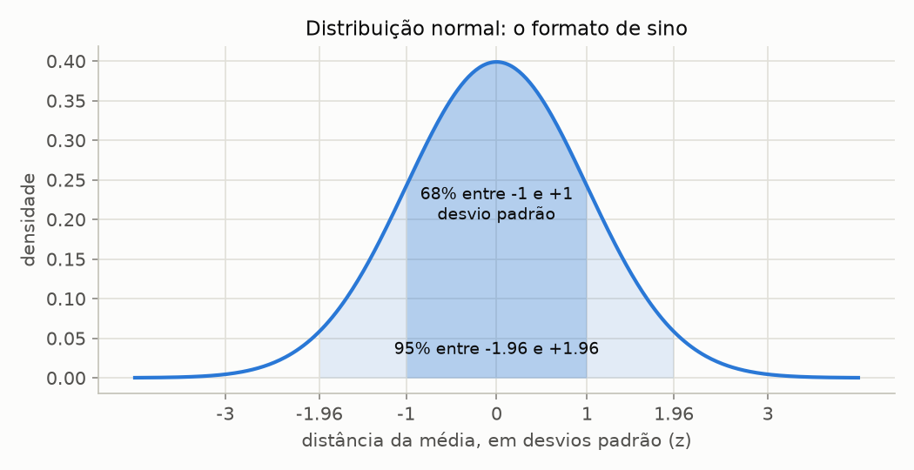

- Definida por **média** (centro) e **desvio padrão** (largura).
- Regra 68-95: ~68% dos valores ficam a até 1 desvio padrão da média; ~95% a até 1.96 (≈ 2) desvios padrão.
- **z-score**: `z = (valor - média) / desvio padrão` = quantos desvios padrão o valor está longe da média. `|z| > 3` é raro (< 0.3% dos casos) -> suspeito.

Por que importa: a regressão supõe que os **erros** são normais (o "N" de LINE). P-valores e intervalos dependem disso.

### 1.4 População vs amostra; parâmetro vs estimativa

**Em 1 frase:** a gente quer saber da população, mas só vê uma amostra; o que calcula na amostra é uma estimativa do valor verdadeiro.

- **População** (*population*): todos os casos de interesse. Ex.: todos os hospitais da região.
- **Amostra** (*sample*): os casos que você tem. Ex.: os 58 hospitais.
- **Parâmetro** (*parameter*): número verdadeiro da população, desconhecido. Letra grega: `β₀`, `β₁`, `σ`.
- **Estimativa** (*estimate*, *statistic*): número calculado da amostra. Letra latina: `b₀`, `b₁`, `S`.

Outra amostra -> outros `b₀`, `b₁`. **Inferência** = usar `b` para dizer algo sobre `β`, com margem de incerteza.

### 1.5 Erro padrão (standard error)

**Em 1 frase:** o desvio padrão de uma estimativa; mede quanto ela mudaria de amostra para amostra.

- Na saída do Python: coluna `std err`.
- Pequeno -> estimativa precisa. Cai quando `n` cresce.
- Hospitais: `b₁ = 0.5689`, erro padrão `0.094`.

**Armadilha:** desvio padrão (espalhamento dos **dados**) ≠ erro padrão (incerteza de uma **estimativa**).

### 1.6 Teste de hipótese e p-valor

**Em 1 frase:** o p-valor mede o quanto os dados seriam surpreendentes se "não houvesse efeito nenhum".

Passo a passo:

1. **H₀, hipótese nula** (*null hypothesis*): "nada acontece". Ex.: `β₁ = 0` (X não tem relação linear com Y).
2. **H₁ ou Hₐ, hipótese alternativa**: `β₁ ≠ 0`.
3. **Estatística de teste**: a quantos erros padrão a estimativa está de H₀. Ex.: `t = b₁ / erro padrão = 0.5689 / 0.094 = 6.04`.
4. **p-valor** (*p-value*): probabilidade de ver um resultado tão extremo quanto o observado **se H₀ fosse verdade**.
5. **Decisão**: `p < α` -> rejeita H₀ -> "estatisticamente significativo". Padrão: `α = 0.05` (5%).

Analogia: tribunal. H₀ = réu inocente. p-valor pequeno = prova forte contra a inocência -> condena (rejeita H₀). p-valor grande = prova insuficiente -> absolve. Absolver não prova inocência.

**Armadilhas:**

- p-valor **não** é a probabilidade de H₀ ser verdadeira.
- "Significativo" ≠ "importante". Efeito minúsculo fica significativo com n enorme.
- Não rejeitar H₀ ≠ provar H₀.

### 1.7 Intervalo de confiança

**Em 1 frase:** faixa de valores plausíveis para um parâmetro, dada a amostra.

- Forma geral: `estimativa ± t* × erro padrão`. Para 95% e n grande, `t* ≈ 2`.
- O que "95%" quer dizer: repetindo a amostragem muitas vezes, 95% dos intervalos construídos assim conteriam o valor verdadeiro.
- Hospitais: IC 95% de `β₁` = `[0.380, 0.757]`.
- Ligação com o teste: IC 95% **não contém 0** ⇔ `p < 0.05` no teste de `β₁ = 0`.

**Armadilha:** não é "95% de chance de β₁ estar nesse intervalo". O intervalo é que varia, `β₁` é fixo.

### 1.8 Graus de liberdade (degrees of freedom)

**Em 1 frase:** quantas informações "sobram livres" depois de estimar os parâmetros.

- Variância de uma amostra: `n - 1` (1 grau gasto para estimar a média).
- Regressão linear simples: `n - 2` (2 graus gastos: `b₀` e `b₁`).
- Hospitais: `58 - 2 = 56` -> linha `Df Residuals: 56` na saída do Python.
- A **distribuição t** (*Student's t*) é um sino com caudas mais grossas que a normal. Quanto mais graus de liberdade, mais parecida com a normal.

---

## 2. Regressão linear simples (STAT501 Lição 1)

### 2.1 Relação determinística vs estatística

**Em 1 frase:** regressão trata de relações com tendência + ruído, não de fórmulas exatas.

- **Determinística** (*deterministic*): X define Y exatamente. Ex.: `°F = 32 + 1.8 × °C`. Todos os pontos caem na reta.
- **Estatística** (*statistical*): X indica a tendência de Y, mas sobra variação. Ex.: dias de internação vs risco de infecção. Pontos espalhados em volta de uma tendência.

### 2.2 Gráfico de dispersão (scatter plot)

**Em 1 frase:** um ponto por observação, X no eixo horizontal, Y no vertical; é o primeiro olhar, antes de qualquer conta.

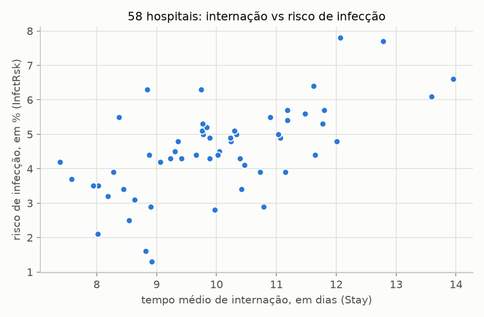

O que observar (e comentar no relatório):

| Aspecto | Pergunta | Hospitais |
|---|---|---|
| Direção | Y sobe ou desce quando X sobe? | sobe (positiva) |
| Forma | Reta, curva, sem padrão? | aproximadamente reta |
| Força | Pontos colados na tendência ou espalhados? | moderada: tendência visível, muita dispersão |
| Dispersão | Espalhamento constante ou abre em funil? | mais ou menos constante |
| Pontos estranhos | Algum ponto longe do resto? | alguns hospitais perto de 9 dias com risco muito baixo (1.3) ou alto (6.3) |
| Concentração | Pontos amontoados numa região? | maioria entre 8 e 12 dias |

```python
import matplotlib.pyplot as plt
import pandas as pd

df = pd.read_csv("docs/data/hospitalinfct_reg1and2.txt", sep="\t")
print(df[["Stay", "InfctRsk"]].describe())

fig, ax = plt.subplots()
ax.scatter(df["Stay"], df["InfctRsk"])
ax.set_xlabel("Stay (dias)")
ax.set_ylabel("InfctRsk (%)")
fig.savefig("dispersao.png", dpi=150)
```

**Armadilha:** comentar só "tem associação". O enunciado pede: existe indício de associação **linear**? Se não, descreva tendência, concentração e dispersão.

### 2.3 A reta: ŷ = b₀ + b₁·x

**Em 1 frase:** a reta resume a tendência; `b₀` é onde ela corta o eixo vertical e `b₁` é sua inclinação.

- `ŷ` ("y chapéu", *fitted value*, valor predito): o Y que a reta prevê para um dado x.
- `b₀`, **intercepto** (*intercept*): valor de ŷ quando `x = 0`.
- `b₁`, **inclinação** (*slope*): quanto ŷ muda quando x aumenta **1 unidade**.

Hospitais: `ŷ = -1.16 + 0.569 × Stay`.

- Cada dia a mais de internação média -> risco de infecção previsto **+0.57 ponto percentual**.
- Hospital com 10 dias -> `ŷ = -1.16 + 0.569 × 10 = 4.53%`.
- Intercepto `-1.16`: risco negativo com 0 dias de internação. Sem sentido, porque `x = 0` está fora dos dados (7.4 a 14 dias).

**Armadilhas:**

- Só interprete `b₀` se `x = 0` faz sentido **e** está perto dos dados observados.
- **Extrapolação** (*extrapolation*): prever fora da faixa de X observada é arriscado. A reta só foi validada dentro dela.
- Reta mostra associação, não causa (ver [2.9](#29-sete-cuidados-com-r²-e-r-stat501-18)).

### 2.4 Resíduo e mínimos quadrados

**Em 1 frase:** resíduo é o erro de cada ponto; mínimos quadrados escolhe a reta com a menor soma de resíduos ao quadrado.

- **Resíduo** (*residual*): `e = y - ŷ` = observado - previsto.
  - `e > 0` -> ponto **acima** da reta. `e < 0` -> **abaixo**.
- **SSE** (*sum of squared errors*): `SSE = Σe²`.
- **Mínimos quadrados** (*least squares*, OLS = *ordinary least squares*): escolhe `b₀`, `b₁` que deixam a SSE mínima.
- Por que ao quadrado: resíduos + e - se cancelariam; quadrado também pune mais os erros grandes.

Fórmulas:

```text
b₁ = Σ(x - x̄)(y - ȳ) / Σ(x - x̄)²
b₀ = ȳ - b₁·x̄
```

Conta na mão. x = horas de estudo, y = nota. `x̄ = 3`, `ȳ = 4.2`.

| x | y | x - x̄ | y - ȳ | (x - x̄)(y - ȳ) | (x - x̄)² | ŷ = 1.8 + 0.8x | e = y - ŷ | e² |
|---|---|---|---|---|---|---|---|---|
| 1 | 2 | -2 | -2.2 | 4.4 | 4 | 2.6 | -0.6 | 0.36 |
| 2 | 4 | -1 | -0.2 | 0.2 | 1 | 3.4 | 0.6 | 0.36 |
| 3 | 5 | 0 | 0.8 | 0 | 0 | 4.2 | 0.8 | 0.64 |
| 4 | 4 | 1 | -0.2 | -0.2 | 1 | 5.0 | -1.0 | 1.00 |
| 5 | 6 | 2 | 1.8 | 3.6 | 4 | 5.8 | 0.2 | 0.04 |
| **Σ** | | | | **8.0** | **10** | | **0** | **2.40** |

- `b₁ = 8 / 10 = 0.8` -> cada hora de estudo vale +0.8 ponto na nota prevista.
- `b₀ = 4.2 - 0.8 × 3 = 1.8`.
- `SSE = 2.4`. Nenhuma outra reta dá SSE menor.

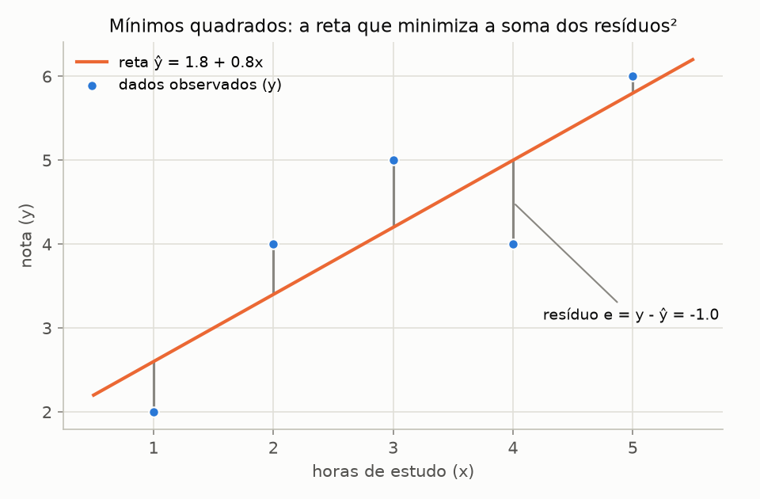

Linhas cinza = resíduos. A reta laranja é a que minimiza a soma dos quadrados dessas distâncias **verticais**.

Fatos que sempre valem na reta de mínimos quadrados:

- Soma dos resíduos = 0.
- A reta passa pelo ponto `(x̄, ȳ)`.

```python
import numpy as np

x = np.array([1, 2, 3, 4, 5])  # study hours
y = np.array([2, 4, 5, 4, 6])  # grade

b1 = ((x - x.mean()) * (y - y.mean())).sum() / ((x - x.mean()) ** 2).sum()
b0 = y.mean() - b1 * x.mean()
y_hat = b0 + b1 * x
residuals = y - y_hat
print(b0, b1)                  # 1.8 0.8
print(residuals)               # [-0.6  0.6  0.8 -1.   0.2]
print((residuals**2).sum())    # SSE = 2.4
```

(O Python imprime `1.7999999999999998` e `2.3999999999999995`: são 1.8 e 2.4 com erro de arredondamento do computador.)

### 2.5 O modelo da população e as premissas LINE

**Em 1 frase:** supomos que cada Y é a reta verdadeira mais um erro aleatório, e esse erro precisa se comportar de 4 jeitos (LINE) para os testes valerem.

```text
Yᵢ = β₀ + β₁·xᵢ + εᵢ
```

- `β₀ + β₁·x` = **média de Y** para aquele x (`μ_Y`), a reta verdadeira.
- `εᵢ` = **erro** (*error*): tudo que X não explica. Não observável.
- `eᵢ` (resíduo) é a **estimativa** de `εᵢ`. Por isso diagnóstico olha resíduos.

Premissas **LINE** (sobre os erros):

| Letra | Nome | Significa |
|---|---|---|
| **L** | *Linear function* | A média de Y muda em linha reta com x |
| **I** | *Independent errors* | O erro de uma observação não diz nada sobre o de outra |
| **N** | *Normally distributed errors* | Em cada x, os erros seguem uma normal |
| **E** | *Equal variances* | A dispersão dos erros (`σ²`) é a mesma em todo x |

Por que importa: `b₀` e `b₁` saem de qualquer jeito. Mas p-valores, IC e IP só são confiáveis se LINE vale. [Seção 5](#5-diagnóstico-pelos-resíduos-stat501-lição-4) ensina a checar.

### 2.6 Variância do erro: MSE e S

**Em 1 frase:** `S` é o tamanho típico do erro de previsão, na unidade de Y.

```text
MSE = SSE / (n - 2)        (mean squared error, estima σ²)
S   = √MSE                 (estima σ)
```

- Mini-exemplo: `MSE = 2.4 / 3 = 0.8`, `S = 0.894` ponto de nota.
- Hospitais: `MSE = 1.0496`, `S = 1.02` ponto percentual de risco. Previsões erram ~1 p.p. tipicamente.
- Divide por `n - 2` porque 2 graus de liberdade foram gastos com `b₀` e `b₁`.

**Armadilha:** a tabela `summary()` do statsmodels não mostra `S`. Pegue com `model.mse_resid ** 0.5` (ver [4](#4-lendo-a-tabela-do-statsmodels-campo-a-campo)).

### 2.7 SSTO = SSR + SSE e o R²

**Em 1 frase:** R² é a fração da variação de Y que a reta explica.

Três somas de quadrados:

| Sigla | Nome | Fórmula | Mede |
|---|---|---|---|
| SSTO | *Total sum of squares* | `Σ(y - ȳ)²` | variação total de Y (erro de "chutar sempre a média") |
| SSE | *Error sum of squares* | `Σ(y - ŷ)²` | variação que sobra, **não explicada** |
| SSR | *Regression sum of squares* | `Σ(ŷ - ȳ)²` | variação **explicada** pela reta |

`SSTO = SSR + SSE` sempre.

```text
R² = SSR / SSTO = 1 - SSE / SSTO          (vai de 0 a 1)
```

- Mini-exemplo: `SSTO = 8.8`, `SSE = 2.4`, `SSR = 6.4` -> `R² = 6.4 / 8.8 = 0.727`.
- Hospitais: `SSR = 38.31`, `SSE = 58.78`, `SSTO = 97.08` -> `R² = 0.395`.
- Leitura: "39.5% da variação do risco de infecção entre hospitais é explicada pela relação linear com o tempo de internação. Os outros 60.5% vêm de fatores fora do modelo."

**R² ajustado** (*adjusted R²*): penaliza preditores extras.

```text
R²_aj = 1 - (1 - R²) × (n - 1) / (n - 2)        (regressão simples)
```

- Hospitais: `1 - 0.605 × 57 / 56 = 0.384`.
- Em regressão simples fica sempre um pouco abaixo do R². Importa mais em regressão múltipla.
- O enunciado pede para comentar o R² ajustado: "o modelo captura bem a variabilidade de Y?". Não existe corte universal. Com 0.38: a reta capta parte da variação, mas a maior parte (~62%) fica sem explicação -> previsões individuais imprecisas (confira a largura do IP em [3.4](#34-ic-da-média-vs-ip-de-uma-nova-observação)).

**Armadilha:** R² só se compara entre modelos com **o mesmo Y, na mesma escala**. Ver [6.6](#66-armadilhas-das-transformações).

### 2.8 Correlação de Pearson r

**Em 1 frase:** número de -1 a 1 que mede direção e força da relação **linear**.

- Sinal = direção (+ sobe junto, - um sobe e o outro desce). Mesmo sinal de `b₁`.
- `|r|` perto de 1 = pontos colados numa reta. Perto de 0 = sem relação **linear**.
- Em regressão simples: `r² = R²`. Hospitais: `r = 0.628` -> `0.628² = 0.394 ≈ R²`.

### 2.9 Sete cuidados com R² e r (STAT501 1.8)

1. Medem só relação **linear**. `R² ≈ 0` pode esconder uma curva perfeita.
2. R² alto **não** prova que a reta é o modelo certo. Uma curva pode descrever melhor. Sempre olhe os resíduos.
3. Um único ponto extremo pode inflar ou derrubar R² e r.
4. Correlação (associação) **não implica causa**. Hospitais com internação longa podem ter pacientes mais graves, e a gravidade é que causaria as infecções.
5. Correlações calculadas sobre médias ou taxas (*ecological correlation*) exageram a força da relação.
6. R² "estatisticamente significativo" não quer dizer que a inclinação é grande ou relevante na prática.
7. R² alto não garante previsão útil. O intervalo de predição ainda pode ser largo demais.

---

## 3. Inferência: testes e intervalos (STAT501 Lições 2 e 3)

### 3.1 Teste t da inclinação

**Em 1 frase:** testa se existe relação linear entre X e Y na população (`β₁ ≠ 0`).

```text
H₀: β₁ = 0        (sem relação linear)
H₁: β₁ ≠ 0
t = b₁ / erro padrão(b₁)       com n - 2 graus de liberdade
```

Hospitais:

- `t = 0.5689 / 0.094 = 6.04`, 56 graus de liberdade.
- `P>|t|` = `0.000` -> p < 0.001 -> rejeita H₀ -> há relação linear entre internação e risco.
- IC 95% de `β₁`: `[0.380, 0.757]`. Leitura: "cada dia a mais de internação está associado a um aumento médio de 0.38 a 0.76 p.p. no risco de infecção".

O que estreita o IC de `β₁`: mais observações, X mais espalhado, `S` menor.

**Armadilha:** a tabela mostra `0.000`, mas p nunca é zero. Escreva "p < 0.001".

### 3.2 E o intercepto?

- Mesmo raciocínio: `H₀: β₀ = 0`. Hospitais: `p = 0.230` -> não significativo.
- Quase nunca interessa (x = 0 costuma estar fora dos dados).
- **Não** remova o intercepto do modelo só porque ele não deu significativo.

### 3.3 Tabela ANOVA e teste F

**Em 1 frase:** compara variação explicada vs não explicada; em regressão simples testa a mesma coisa que o t da inclinação.

| Fonte | GL | SS | MS = SS / GL | F |
|---|---|---|---|---|
| Regressão | 1 | SSR = 38.31 | MSR = 38.31 | MSR / MSE = 36.50 |
| Erro (resíduo) | n - 2 = 56 | SSE = 58.78 | MSE = 1.05 | |
| Total | n - 1 = 57 | SSTO = 97.08 | | |

- `F = 36.50`, p = `1.30e-07` (= 0.000000130).
- Em regressão simples: `F = t²` -> `6.04² = 36.5`. Mesmo p-valor. Mesma conclusão.

```python
import statsmodels.api as sm
import statsmodels.formula.api as smf

model = smf.ols("InfctRsk ~ Stay", data=df).fit()
print(sm.stats.anova_lm(model))
```

```text
            df     sum_sq    mean_sq          F        PR(>F)
Stay       1.0  38.305918  38.305918  36.496522  1.302453e-07
Residual  56.0  58.776324   1.049577        NaN           NaN
```

`"InfctRsk ~ Stay"` = fórmula "Y explicado por X". O intercepto entra automaticamente.

### 3.4 IC da média vs IP de uma nova observação

**Em 1 frase:** o IC diz onde está a **média** de Y para um x; o IP diz onde deve cair **um caso novo**.

| | IC da média (*confidence interval for the mean response*) | IP (*prediction interval for a new response*) |
|---|---|---|
| Pergunta | Qual o risco **médio** dos hospitais com 10 dias? | Qual o risco de **um hospital novo** com 10 dias? |
| Incerteza | só da posição da reta | da reta **+** variação individual (`σ²`) |
| Largura | estreito | sempre mais largo |
| Hospitais, Stay = 10 | `[4.26, 4.80]` | `[2.46, 6.60]` |

Ambos centrados em `ŷ = 4.53`.

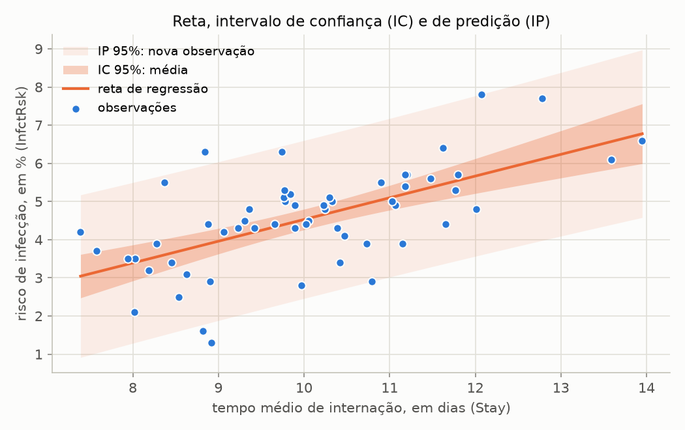

- Os dois são mais estreitos perto da média de X (`x̄ = 10.05` dias) e abrem nas pontas -> extrapolação é arriscada.
- Mais dados -> IC encolhe quase até virar a reta. O IP nunca fica mais estreito que a variação natural (~±2S).
- O IP depende muito da premissa **N** (normalidade). Normalidade ruim -> IP não confiável.

```python
new = pd.DataFrame({"Stay": [10]})
print(model.get_prediction(new).summary_frame(alpha=0.05))
```

```text
       mean   mean_se  mean_ci_lower  mean_ci_upper  obs_ci_lower  obs_ci_upper
0  4.528846  0.134602       4.259205       4.798486       2.45891      6.598781
```

`mean` = ŷ; `mean_ci_*` = IC; `obs_ci_*` = IP. Gráfico com as faixas:

```python
import numpy as np

grid = pd.DataFrame({"Stay": np.linspace(df["Stay"].min(), df["Stay"].max(), 100)})
bands = model.get_prediction(grid).summary_frame(alpha=0.05)

fig, ax = plt.subplots()
ax.scatter(df["Stay"], df["InfctRsk"], label="dados")
ax.plot(grid["Stay"], bands["mean"], label="reta")
ax.fill_between(grid["Stay"], bands["mean_ci_lower"], bands["mean_ci_upper"], alpha=0.3, label="IC 95%")
ax.fill_between(grid["Stay"], bands["obs_ci_lower"], bands["obs_ci_upper"], alpha=0.1, label="IP 95%")
ax.legend()
fig.savefig("ic_ip.png", dpi=150)
```

---

## 4. Lendo a tabela do statsmodels campo a campo

É a tabela que o enunciado pede em 3.1.2. Saída para os hospitais:

```python
print(model.summary())
```

```text
                            OLS Regression Results
==============================================================================
Dep. Variable:               InfctRsk   R-squared:                       0.395
Model:                            OLS   Adj. R-squared:                  0.384
Method:                 Least Squares   F-statistic:                     36.50
Date:                Sun, 11 Oct 2026   Prob (F-statistic):           1.30e-07
Time:                        17:09:56   Log-Likelihood:                -82.684
No. Observations:                  58   AIC:                             169.4
Df Residuals:                      56   BIC:                             173.5
Df Model:                           1
Covariance Type:            nonrobust
==============================================================================
                 coef    std err          t      P>|t|      [0.025      0.975]
------------------------------------------------------------------------------
Intercept     -1.1598      0.956     -1.213      0.230      -3.075       0.755
Stay           0.5689      0.094      6.041      0.000       0.380       0.757
==============================================================================
Omnibus:                        1.579   Durbin-Watson:                   2.075
Prob(Omnibus):                  0.454   Jarque-Bera (JB):                0.839
Skew:                          -0.170   Prob(JB):                        0.657
Kurtosis:                       3.481   Cond. No.                         72.8
==============================================================================
```

### Bloco 1: o modelo como um todo

| Campo | O que é | Hospitais | Comentar? |
|---|---|---|---|
| `Dep. Variable` | Y | `InfctRsk` | |
| `Model`, `Method` | OLS = mínimos quadrados ([2.4](#24-resíduo-e-mínimos-quadrados)) | | |
| `No. Observations` | n | 58 | citar |
| `Df Residuals` | graus de liberdade do erro, n - 2 | 56 | |
| `Df Model` | número de preditores | 1 | |
| `Covariance Type` | `nonrobust` = erros padrão clássicos (supõem LINE) | | |
| `R-squared` | R² ([2.7](#27-ssto--ssr--sse-e-o-r²)) | 0.395 | sim |
| `Adj. R-squared` | R² ajustado | 0.384 | **sim, pedido** |
| `F-statistic`, `Prob (F-statistic)` | teste F ([3.3](#33-tabela-anova-e-teste-f)) | 36.50, 1.30e-07 | sim |
| `Log-Likelihood`, `AIC`, `BIC` | para comparar modelos **com o mesmo Y**; menor AIC/BIC = melhor | | opcional |

### Bloco 2: os coeficientes

| Coluna | O que é | Linha `Stay` |
|---|---|---|
| `coef` | estimativa (`b₀` na linha `Intercept`, `b₁` na linha do X) | 0.5689 |
| `std err` | erro padrão ([1.5](#15-erro-padrão-standard-error)) | 0.094 |
| `t` | `coef / std err` ([3.1](#31-teste-t-da-inclinação)) | 6.041 |
| `P>\|t\|` | p-valor do teste `β = 0` | 0.000 -> p < 0.001 |
| `[0.025  0.975]` | IC 95% do parâmetro ([1.7](#17-intervalo-de-confiança)) | [0.380, 0.757] |

### Bloco 3: testes automáticos dos resíduos

Estes vão além das Lições 1 a 4 do STAT501. São testes que **complementam** os gráficos da [seção 5](#5-diagnóstico-pelos-resíduos-stat501-lição-4), não substituem.

| Campo | O que é | Leitura | Hospitais |
|---|---|---|---|
| `Omnibus`, `Prob(Omnibus)` | teste de normalidade dos resíduos. H₀: resíduos normais | p alto -> sem evidência contra a normalidade | 1.579, p = 0.454 -> ok |
| `Jarque-Bera (JB)`, `Prob(JB)` | outro teste de normalidade, baseado em `Skew` e `Kurtosis` | idem | 0.839, p = 0.657 -> ok |
| `Skew` | assimetria. 0 = simétrico; > 0 cauda longa à direita; < 0 à esquerda | perto de 0 é bom | -0.170 |
| `Kurtosis` | "peso das caudas". Normal = 3; > 3 caudas pesadas | perto de 3 é bom | 3.481 |
| `Durbin-Watson` | correlação entre resíduos vizinhos **na ordem das linhas** | ≈ 2 ok; < 1.5 correlação positiva; > 2.5 negativa (regra de bolso) | 2.075 -> ok |
| `Cond. No.` | número de condição. Importa em regressão múltipla (preditores redundantes) | em regressão simples só reflete a escala de X; pode ignorar | 72.8 |

**Armadilhas:**

- n pequeno -> testes de normalidade quase nunca rejeitam (pouco poder). n grande -> rejeitam por desvios mínimos. Gráfico primeiro, teste depois.
- `Durbin-Watson` só faz sentido se a ordem das linhas é a ordem de coleta (ex.: tempo).

Valores soltos para usar no texto:

```python
print(model.params)            # b0 (Intercept) and b1 (Stay)
print(model.rsquared)          # R²
print(model.rsquared_adj)      # adjusted R²
print(model.mse_resid)         # MSE
print(model.mse_resid**0.5)    # S
```

---

## 5. Diagnóstico pelos resíduos (STAT501 Lição 4)

### 5.1 A ideia

**Em 1 frase:** se o modelo está certo, os resíduos são só ruído sem padrão; qualquer padrão é algo que o modelo deixou escapar.

Cada gráfico de resíduo checa uma ou mais letras de LINE:

| Gráfico | Checa |
|---|---|
| Resíduo vs predito | **L** (curva?), **E** (funil?), outliers |
| Histograma dos resíduos | **N** |
| QQ-plot | **N** |
| Resíduo vs ordem de coleta | **I** |

### 5.2 Resíduos vs valores preditos (residuals vs fits)

**Em 1 frase:** eixo horizontal = ŷ, vertical = resíduo, linha em 0; queremos uma nuvem sem forma.

Gráfico "bem-comportado" (STAT501 4.2):

1. Resíduos **pulam aleatoriamente** em volta do 0 -> **L** ok.
2. Formam uma **faixa horizontal** de largura constante -> **E** ok.
3. **Nenhum ponto se destaca** do resto -> sem outliers.

Hospitais: nuvem sem curva, faixa mais ou menos constante, maior resíduo ≈ 2.6 (≈ 2.5 × S). Bem-comportado.

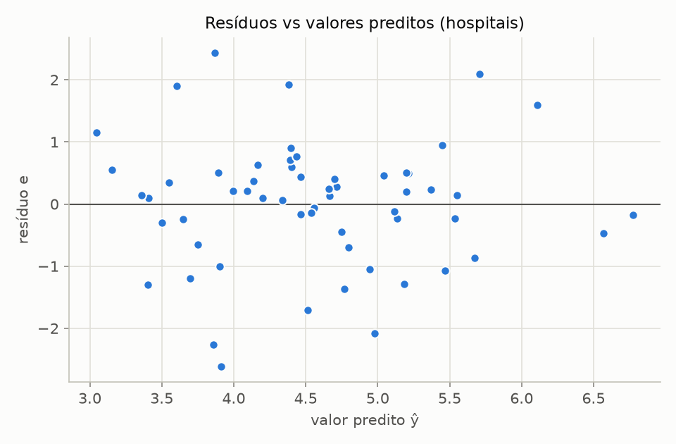

Os 4 casos típicos (dados simulados). Linha de cima: dados + reta. Linha de baixo: resíduo vs predito.

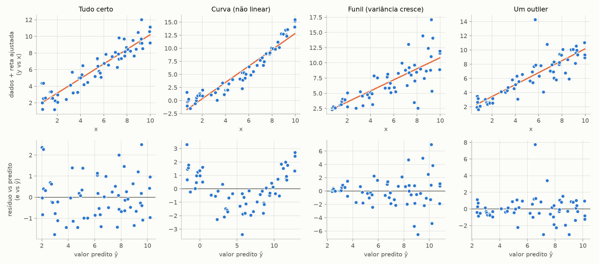

| Padrão | O que aparece | Premissa violada | Remédio |
|---|---|---|---|
| Tudo certo | nuvem horizontal sem forma | nenhuma | |
| Curva | resíduos formam U ou arco (+, -, +) | **L** | transformar X e/ou Y ([6](#6-transformações-de-escala-stat501-lição-9)) |
| Funil (*fanning*) | espalhamento cresce (ou diminui) com ŷ | **E** | transformar Y (log, raiz) |
| Outlier | um ponto muito longe dos outros | (ponto atípico) | investigar, ver abaixo |

Repare: no caso "Curva" a reta parece razoável no gráfico de cima. O resíduo amplia o problema. Por isso o enunciado pede os dois.

Outlier: **resíduo padronizado** = `e / S` (resíduo em unidades de desvio padrão). `|e / S| > 3` -> suspeito. O que fazer (STAT501 4.4):

1. Erro de digitação ou registro? Corrija.
2. Medição fora do protocolo ou caso fora da população de interesse? Remova, **justificando**.
3. Nenhum dos dois? Analise **com e sem** o ponto e reporte ambos.

**Armadilha:** em regressão simples, resíduo vs X (*residuals vs predictor*) é o mesmo desenho que resíduo vs ŷ, só com o eixo reescalado. Um basta.

### 5.3 Histograma dos resíduos

**Em 1 frase:** mostra o formato da distribuição dos resíduos; queremos um sino centrado em 0.

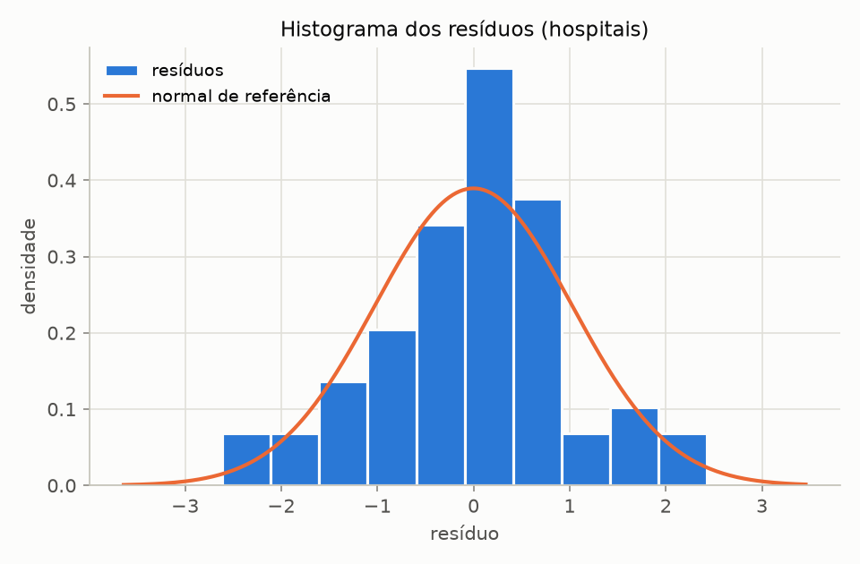

- Sobreponha a normal com média 0 e desvio padrão `S` (curva laranja).
- Hospitais: formato de sino, centrado em 0, simétrico o bastante -> **N** razoável.

**Armadilha:** com n pequeno o histograma muda muito conforme o número de barras. Não serve. Por isso o enunciado dispensa o histograma do Treadwear (n = 9). O QQ-plot funciona melhor com n pequeno.

### 5.4 QQ-plot (normal probability plot)

**Em 1 frase:** compara os resíduos ordenados com o que uma normal perfeita daria; se forem normais, os pontos ficam em cima da reta.

Como funciona: ordena os resíduos do menor para o maior e coloca cada um contra o quantil esperado de uma normal (eixo horizontal). O STAT501 chama de *normal probability plot*; no Python é `qqplot`.

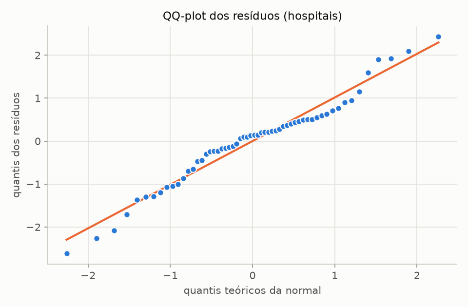

Hospitais: pontos perto da reta, pequenos desvios nas pontas -> **N** razoável. Combina com `Prob(Omnibus) = 0.454` e `Prob(JB) = 0.657`.

Padrões (STAT501 4.6, dados simulados):

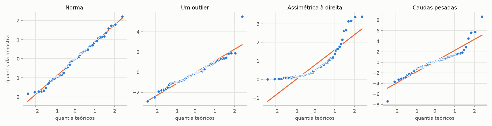

| Padrão | Formato | Leitura |
|---|---|---|
| Normal | pontos sobre a reta | **N** ok |
| Um outlier | reta boa, um ponto isolado numa ponta | investigar o ponto |
| Assimétrica à direita | curva (pontos acima da reta nas duas pontas, formato de banana) | **N** violada; log ou raiz em Y costuma ajudar |
| Caudas pesadas | formato de S: ponta de baixo abaixo da reta, ponta de cima acima | **N** violada; extremos mais frequentes que na normal |

**Armadilha:** com n pequeno, um pouco de desvio nas pontas é esperado mesmo com erros normais. Procure padrões claros, não perfeição.

### 5.5 Independência

**Em 1 frase:** o erro de uma observação não pode ajudar a prever o erro de outra.

Quando costuma falhar:

- Dados no **tempo** (medidas em sequência): erro de hoje parecido com o de ontem.
- **Grupos**: várias medidas do mesmo local, pessoa ou lote.

Como checar:

- **Resíduo vs ordem de coleta** (*residuals vs order*, STAT501 4.5), **só** se a ordem das linhas for a ordem de coleta.
- `Durbin-Watson` ([4](#4-lendo-a-tabela-do-statsmodels-campo-a-campo)).
- Sem ordem conhecida: argumente pelo **modo como os dados foram coletados**. Esse é o comentário esperado na maioria dos casos.

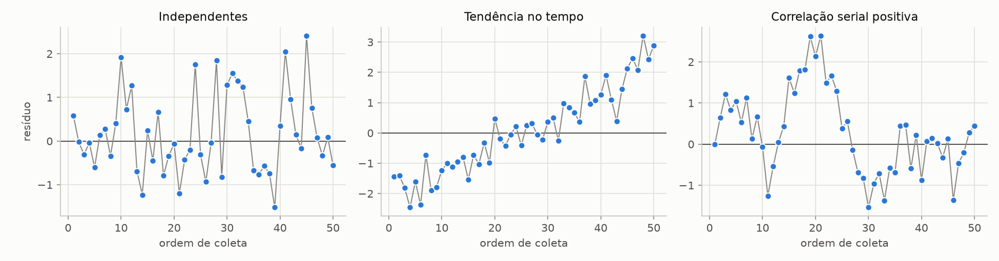

Esquerda: sem padrão (ok). Meio: tendência no tempo. Direita: correlação serial positiva (resíduos vizinhos parecidos, ondas longas).

```python
from statsmodels.stats.stattools import durbin_watson

print(durbin_watson(model.resid))  # 2.075
```

**Armadilha:** transformação de escala **não** conserta falta de independência.

### 5.6 Checklist LINE

| Premissa | Pergunta | Onde olhar | OK quando | Violada quando |
|---|---|---|---|---|
| **L** linear | A tendência é reta? | dispersão; resíduo vs predito | resíduos sem curva em volta do 0 | U, arco, curva |
| **I** independente | Um erro informa o outro? | coleta dos dados; resíduo vs ordem; Durbin-Watson | sem ordem/grupo, sem padrão, DW ≈ 2 | ondas, tendência, grupos |
| **N** normal | Resíduos têm forma de sino? | histograma; QQ-plot; Omnibus/JB | sino; pontos na reta do QQ | banana, S, ponto isolado |
| **E** variância igual | Espalhamento constante? | resíduo vs predito | faixa de largura constante | funil abrindo ou fechando |

Modelo de comentário para 3.1.3: "**L**: [aparentemente válida / violada], pois o gráfico de resíduos vs preditos [não mostra / mostra] [padrão]. **I**: [...]. **N**: [...]. **E**: [...]."

```python
import scipy.stats as st
import statsmodels.api as sm

residuals = model.resid
fitted = model.fittedvalues
s = model.mse_resid**0.5

fig, ax = plt.subplots()
ax.hist(residuals, bins=10, density=True)
grid_res = np.linspace(residuals.min(), residuals.max(), 200)
ax.plot(grid_res, st.norm.pdf(grid_res, loc=0, scale=s))
fig.savefig("histograma.png", dpi=150)

fig, ax = plt.subplots()
ax.scatter(fitted, residuals)
ax.axhline(0, color="red", linestyle="--")
ax.set_xlabel("valor predito")
ax.set_ylabel("resíduo")
fig.savefig("residuos_preditos.png", dpi=150)

fig, ax = plt.subplots()
sm.qqplot(residuals, line="s", ax=ax)
fig.savefig("qqplot.png", dpi=150)
```

---

## 6. Transformações de escala (STAT501 Lição 9)

### 6.1 Por que transformar

**Em 1 frase:** quando L, E ou N falham, mudar a escala de X e/ou Y pode deixar a relação reta e o espalhamento constante.

- Continua sendo regressão **linear**: linear nas variáveis transformadas. Ex.: `log10(Y) = b₀ + b₁·X`.
- A Lição 9 do STAT501 não está entre as Lições 1 a 4 citadas no enunciado, mas é ela que cobre a etapa 3.2.

### 6.2 As três transformações da tarefa

| Transformação | Efeito | Exemplo | Exige |
|---|---|---|---|
| Raiz quadrada `√v` | **comprime** valores grandes, de leve | 1 -> 1, 100 -> 10, 10000 -> 100 | v ≥ 0 |
| Quadrado `v²` | **estica** valores grandes | 2 -> 4, 10 -> 100 | qualquer v (cuidado com negativos: -2 e 2 viram 4) |
| `log10(v)` | **comprime forte**; multiplicar vira somar | 1 -> 0, 10 -> 1, 100 -> 2, 1000 -> 3 | v > 0 |

Por que `log10` e não `ln`: o professor prefere log10 porque `+1` em log10 = `×10` na escala original. Fácil de ler.

Regra do formato da curva (veja a [figura de 6.4](#64-testando-as-9-combinações)):

| Curva na dispersão | Opções |
|---|---|
| **acelera** (cresce cada vez mais rápido, tipo exponencial) | comprimir Y (`√Y`, `log10 Y`) ou esticar X (`X²`) |
| **desacelera** (cresce cada vez mais devagar, satura) | comprimir X (`√X`, `log10 X`) ou esticar Y (`Y²`) |

### 6.3 Transformar X, Y ou os dois?

Regra de bolso do STAT501 (9.4 e 9.5):

- **Só curva**, e resíduos com faixa constante e normais -> transforme **X**. Mexer em Y estragaria erros que estavam bons.
- **Funil e/ou resíduos assimétricos** (com ou sem curva) -> transforme **Y**. Mexer em Y muda a distribuição dos erros: costuma consertar E e N juntos.
- **As duas variáveis espalhadas por várias ordens de grandeza** (ex.: 10, 1000, 100000) -> `log10` nas duas costuma ajudar.

A tarefa pede testar todas as 9 e escolher pelo gráfico. A regra ajuda a **justificar** a escolha.

### 6.4 Testando as 9 combinações

3 transformações × 3 alvos (só X, só Y, ambos) = 9 gráficos de dispersão. Procure o que tem:

1. nuvem mais **reta**;
2. espalhamento mais **constante** ao longo de X.

Exemplo simulado (dados que crescem multiplicativamente):

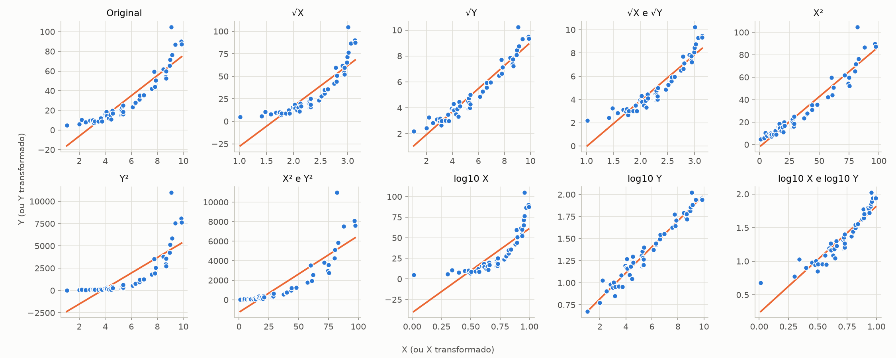

- `Original`: curva que acelera + funil.
- `log10 Y`: reta e espalhamento constante -> **vencedora**.
- `X²`: parece quase reta, mas o funil continua -> perde para `log10 Y`.
- `√Y`: melhora, mas ainda curva um pouco.
- `log10 X` e `Y²`: pioram a curva (comprimem o lado errado).

```python
import matplotlib.pyplot as plt
import numpy as np


def identity(values):
    return values


x_col, y_col = "Stay", "InfctRsk"
combos = []
for name, f in [("raiz", np.sqrt), ("quadrado", np.square), ("log10", np.log10)]:
    combos += [
        (f"{name}(X)", f, identity),
        (f"{name}(Y)", identity, f),
        (f"{name}(X) e {name}(Y)", f, f),
    ]

fig, axes = plt.subplots(3, 3, figsize=(12, 10))
for ax, (title, fx, fy) in zip(axes.flat, combos):
    ax.scatter(fx(df[x_col]), fy(df[y_col]))
    ax.set_title(title)
fig.tight_layout()
fig.savefig("nove_transformacoes.png", dpi=150)
```

Troque `df`, `x_col` e `y_col` por cada dataset da tarefa. O enunciado diz que esses 9 gráficos **não** precisam ir para o relatório.

### 6.5 Ajustar e interpretar o modelo transformado

Cria a coluna transformada, ajusta igual a antes, refaz **todo** o diagnóstico (etapa 3.3).

Demonstração com os hospitais (só para mostrar a mecânica: ali o modelo original já estava bom):

```python
import numpy as np
import pandas as pd
import statsmodels.formula.api as smf

df["log_risk"] = np.log10(df["InfctRsk"])
log_model = smf.ols("log_risk ~ Stay", data=df).fit()
print(log_model.params)                  # Intercept 0.0622, Stay 0.0573
print(10 ** log_model.params["Stay"])    # 1.1409

pred = log_model.get_prediction(pd.DataFrame({"Stay": [10]})).summary_frame(alpha=0.05)
print(10 ** pred[["mean", "obs_ci_lower", "obs_ci_upper"]])  # back to % scale
```

```text
      mean  obs_ci_lower  obs_ci_upper
0  4.31296      2.453347      7.582142
```

- Modelo: `log10(ŷ) = 0.0622 + 0.0573 × Stay`.
- `10^0.0573 = 1.141` -> cada dia a mais **multiplica** o risco previsto por 1.14 (+14%).
- Previsão volta para a escala original com `10^(...)`: Stay = 10 -> 4.31%, IP `[2.45, 7.58]`. O IP fica **assimétrico** na escala original. Normal.

Como ler `b₁` em cada modelo:

| Modelo | Leitura de b₁ |
|---|---|
| `Y ~ X` | X +1 -> Y muda `b₁` unidades |
| `log10(Y) ~ X` | X +1 -> Y é **multiplicado** por `10^b₁` |
| `Y ~ log10(X)` | X **×10** -> Y muda `b₁` unidades |
| `log10(Y) ~ log10(X)` | X ×10 -> Y × `10^b₁`. Equivalente: X +1% -> Y ≈ +`b₁`% (elasticidade) |
| com `√` ou `²` | leitura direta é ruim; descreva na escala transformada e foque em se LINE melhorou |

### 6.6 Armadilhas das transformações

**Log ou raiz de zero ou negativo.** `log10(0) = -∞`. O NumPy avisa `RuntimeWarning: divide by zero encountered in log10` e o statsmodels quebra depois com `LinAlgError: SVD did not converge`. Cheque antes:

```python
print((df["InfctRsk"] <= 0).sum())  # rows that break log10 (0 here)
```

Se houver zeros, escolha e **justifique no relatório**:

- remover as linhas com zero (diga quantas e por quê);
- somar uma constante antes do log, ex.: `log10(v + 1)` (muda a interpretação; diga qual constante);
- preferir `√`, que aceita zero.

Na dúvida, pergunte ao professor qual ele espera.

**R² de modelos com Y diferentes não se compara.** R² de `log10(Y) ~ X` mede a variação de `log10(Y)` explicada, não a de Y. Escolha a transformação pelo gráfico de dispersão e pelos resíduos, como o enunciado pede. Entre modelos que só mudam X (mesmo Y), R² se compara.

**Refazer o diagnóstico.** Transformação que endireita a dispersão pode criar funil ou assimetria nova. A etapa 3.3 pede todos os gráficos de novo.

**Não remova pontos para a transformação "funcionar melhor".** (STAT501 9.4.)

---

## 7. Roteiro da tarefa

Para **cada** dataset (Treadwear, Alligators, ConcPatog):

1. **3.1 Dados originais**
   - [ ] Dispersão Y vs X + comentário ([2.2](#22-gráfico-de-dispersão-scatter-plot))
   - [ ] `model.summary()` + comentário do R² ajustado ([4](#4-lendo-a-tabela-do-statsmodels-campo-a-campo), [2.7](#27-ssto--ssr--sse-e-o-r²))
   - [ ] Reta + IC + IP ([3.4](#34-ic-da-média-vs-ip-de-uma-nova-observação))
   - [ ] Histograma (exceto Treadwear), resíduo vs predito, QQ-plot ([5](#5-diagnóstico-pelos-resíduos-stat501-lição-4))
   - [ ] LINE: quais valem, quais falham ([5.6](#56-checklist-line))
2. **3.2 Transformações**
   - [ ] 9 dispersões, numa figura 3x3, com a tabela de R² ajustado ([6.4](#64-testando-as-9-combinações))
   - [ ] Escolher a combinação e justificar ([6.3](#63-transformar-x-y-ou-os-dois))
3. **3.3 Combinação escolhida**
   - [ ] Dizer qual é
   - [ ] Repetir todo o passo 1 com as variáveis transformadas ([6.5](#65-ajustar-e-interpretar-o-modelo-transformado))

Carregar os dados:

```python
import pandas as pd

treadwear = pd.read_csv("data/treadwear.txt", sep="\t")
alligator = pd.read_csv("data/alligator.txt", sep=r"\s+")
conc = pd.read_csv("data/ConcPatog.txt", sep="\t")
print(len(treadwear), len(alligator), len(conc))  # 9 25 105
```

`alligator.txt` é separado por espaços (`sep=r"\s+"`); os outros dois, por tab (`sep="\t"`).

O que saber de cada um:

| Dataset | n | Atenção |
|---|---|---|
| Treadwear | 9 | amostra minúscula: sem histograma no relatório; QQ-plot e testes com pouca força. **`mileage = 0` na 1ª linha** -> `log10 X` quebra ([6.6](#66-armadilhas-das-transformações)) |
| Alligators | 25 | |
| ConcPatog | 105 | **3 linhas com `CPatog1 = 0`** -> `log10 X` quebra ([6.6](#66-armadilhas-das-transformações)); medidas agrupadas por estação, estágio e mês -> pense na premissa **I** ([5.5](#55-independência)) |

Tudo abaixo sai pronto com `uv run python -m atividade_1_regressao`, para os 3 datasets. As combinações com `log10` de X removem as linhas com X = 0, e a escolhida de cada dataset fica no campo `chosen` de `datasets.py`. O `.tex` em `entrega_final/` puxa cada arquivo de `outputs/` sozinho ao recompilar:

| Arquivo | Conteúdo |
|---|---|
| `outputs/<dataset>/<etapa>_dispersao.png` | dispersão |
| `outputs/<dataset>/<etapa>_ols.txt` | `model.summary().as_text()` |
| `outputs/<dataset>/<etapa>_icip.png` | reta + IC + IP |
| `outputs/<dataset>/<etapa>_histograma.png` | histograma (gerado para os 3; o relatório não usa o do treadwear) |
| `outputs/<dataset>/<etapa>_residuos_preditos.png` | resíduo vs predito |
| `outputs/<dataset>/<etapa>_qqplot.png` | QQ-plot |
| `outputs/<dataset>/transformacoes.png` | as 9 dispersões transformadas, com R² ajustado e n |
| `outputs/<dataset>/transformacoes.tex` | tabela LaTeX do R² ajustado das 9, com a escolhida em negrito |

`<dataset>` = `treadwear`, `alligators` ou `concpatog`. `<etapa>` = `original` ou `transformado`.

```python
from pathlib import Path

outputs = Path("outputs/treadwear")
outputs.mkdir(parents=True, exist_ok=True)
(outputs / "original_ols.txt").write_text(model.summary().as_text())
```

Antes de entregar:

- [ ] Nenhum texto vermelho (`\pendente`) sobrando no PDF.
- [ ] Nome completo e Número USP dos dois na 1ª página.
- [ ] Nenhum código Python no relatório (o enunciado proíbe).
- [ ] Prazo: **13/10**, pelo e-disciplinas, só um da dupla envia.

---

## 8. Glossário PT/EN

| Termo | Inglês / Python | Em 1 frase | Seção |
|---|---|---|---|
| Assimetria | *skewness*, `Skew` | quanto a distribuição pende para um lado | [4](#4-lendo-a-tabela-do-statsmodels-campo-a-campo) |
| Coeficiente de determinação | *R-squared* | fração da variação de Y explicada pela reta | [2.7](#27-ssto--ssr--sse-e-o-r²) |
| Correlação de Pearson | *correlation coefficient*, r | direção e força da relação linear, de -1 a 1 | [2.8](#28-correlação-de-pearson-r) |
| Curtose | *kurtosis*, `Kurtosis` | peso das caudas; normal = 3 | [4](#4-lendo-a-tabela-do-statsmodels-campo-a-campo) |
| Desvio padrão | *standard deviation* | espalhamento típico dos dados em volta da média | [1.2](#12-média-variância-e-desvio-padrão) |
| Erro (do modelo) | *error*, ε | parte de Y que a reta verdadeira não explica | [2.5](#25-o-modelo-da-população-e-as-premissas-line) |
| Erro padrão | *standard error*, `std err` | incerteza de uma estimativa | [1.5](#15-erro-padrão-standard-error) |
| Estimativa | *estimate*, b₀, b₁ | número calculado na amostra | [1.4](#14-população-vs-amostra-parâmetro-vs-estimativa) |
| Extrapolação | *extrapolation* | prever fora da faixa de X observada | [2.3](#23-a-reta-ŷ--b₀--b₁x) |
| Graus de liberdade | *degrees of freedom*, `Df` | informações livres após estimar parâmetros | [1.8](#18-graus-de-liberdade-degrees-of-freedom) |
| Hipótese nula | *null hypothesis*, H₀ | "não há efeito" | [1.6](#16-teste-de-hipótese-e-p-valor) |
| Inclinação | *slope*, b₁ | mudança em ŷ por unidade de x | [2.3](#23-a-reta-ŷ--b₀--b₁x) |
| Intercepto | *intercept*, b₀ | ŷ quando x = 0 | [2.3](#23-a-reta-ŷ--b₀--b₁x) |
| Intervalo de confiança | *confidence interval*, IC | faixa plausível para um parâmetro ou para a média de Y | [1.7](#17-intervalo-de-confiança), [3.4](#34-ic-da-média-vs-ip-de-uma-nova-observação) |
| Intervalo de predição | *prediction interval*, IP | faixa onde deve cair uma nova observação | [3.4](#34-ic-da-média-vs-ip-de-uma-nova-observação) |
| LINE | *Linear, Independent, Normal, Equal variance* | as 4 premissas sobre os erros | [2.5](#25-o-modelo-da-população-e-as-premissas-line) |
| Mínimos quadrados | *least squares*, OLS | reta que minimiza a soma dos resíduos² | [2.4](#24-resíduo-e-mínimos-quadrados) |
| MSE | *mean squared error* | SSE / (n - 2), estima σ² | [2.6](#26-variância-do-erro-mse-e-s) |
| Outlier | *outlier* | ponto muito fora do padrão dos outros | [5.2](#52-resíduos-vs-valores-preditos-residuals-vs-fits) |
| p-valor | *p-value*, `P>\|t\|` | quão surpreendente seria o resultado se H₀ fosse verdade | [1.6](#16-teste-de-hipótese-e-p-valor) |
| Parâmetro | *parameter*, β₀, β₁, σ | valor verdadeiro da população, desconhecido | [1.4](#14-população-vs-amostra-parâmetro-vs-estimativa) |
| QQ-plot | *normal probability plot*, `qqplot` | resíduos ordenados vs quantis da normal | [5.4](#54-qq-plot-normal-probability-plot) |
| R² ajustado | *adjusted R-squared* | R² com penalidade por preditor | [2.7](#27-ssto--ssr--sse-e-o-r²) |
| Resíduo | *residual*, e | observado - previsto | [2.4](#24-resíduo-e-mínimos-quadrados) |
| Resíduo padronizado | *standardized residual* | resíduo em unidades de desvio padrão; \|·\| > 3 é suspeito | [5.2](#52-resíduos-vs-valores-preditos-residuals-vs-fits) |
| S | *standard error of the regression* | erro típico de previsão, √MSE | [2.6](#26-variância-do-erro-mse-e-s) |
| SSE, SSR, SSTO | *sums of squares* | variação não explicada, explicada e total | [2.7](#27-ssto--ssr--sse-e-o-r²) |
| Valor predito | *fitted value*, ŷ | o Y que a reta prevê | [2.3](#23-a-reta-ŷ--b₀--b₁x) |
| Variável preditora | *predictor*, X | o que se usa para explicar Y | [1.1](#11-dados-observação-variável-x-e-y) |
| Variável resposta | *response*, Y | o que se quer explicar | [1.1](#11-dados-observação-variável-x-e-y) |
| Variância | *variance* | média dos desvios ao quadrado | [1.2](#12-média-variância-e-desvio-padrão) |

---

## Referências

- STAT 501, Penn State. [Lição 1: Simple Linear Regression](https://online.stat.psu.edu/stat501/Lesson01.html)
- STAT 501, Penn State. [Lição 2: SLR Model Evaluation](https://online.stat.psu.edu/stat501/Lesson02.html)
- STAT 501, Penn State. [Lição 3: SLR Estimation & Prediction](https://online.stat.psu.edu/stat501/Lesson03.html)
- STAT 501, Penn State. [Lição 4: SLR Model Assumptions](https://online.stat.psu.edu/stat501/Lesson04.html)
- STAT 501, Penn State. [Lição 9: Data Transformations](https://online.stat.psu.edu/stat501/Lesson09.html)
- Dados do exemplo: [`hospitalinfct_reg1and2.txt`](https://online.stat.psu.edu/stat501/Data_files/hospitalinfct_reg1and2.txt) (STAT501, Exemplo 3.1).
